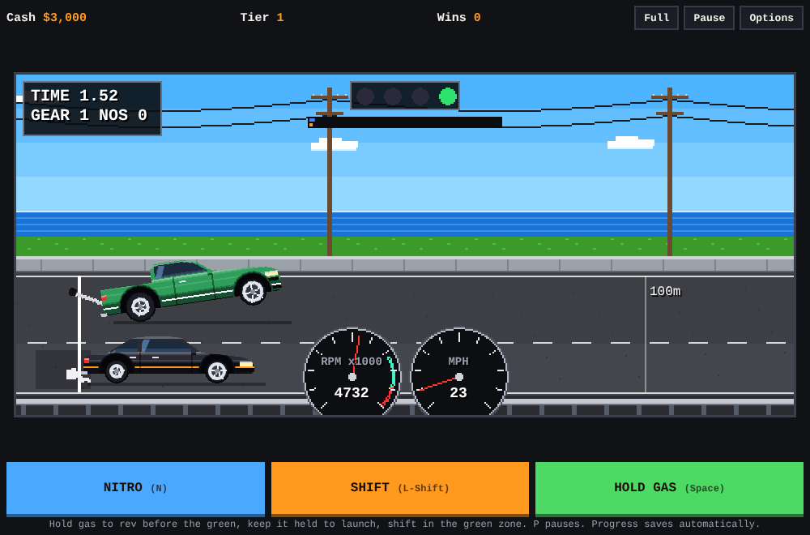
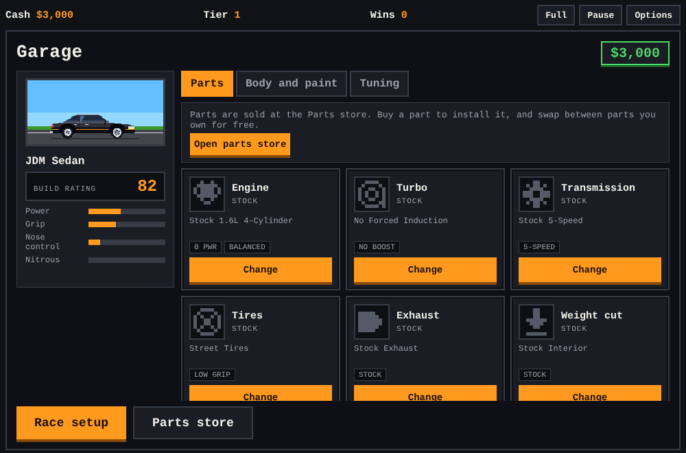
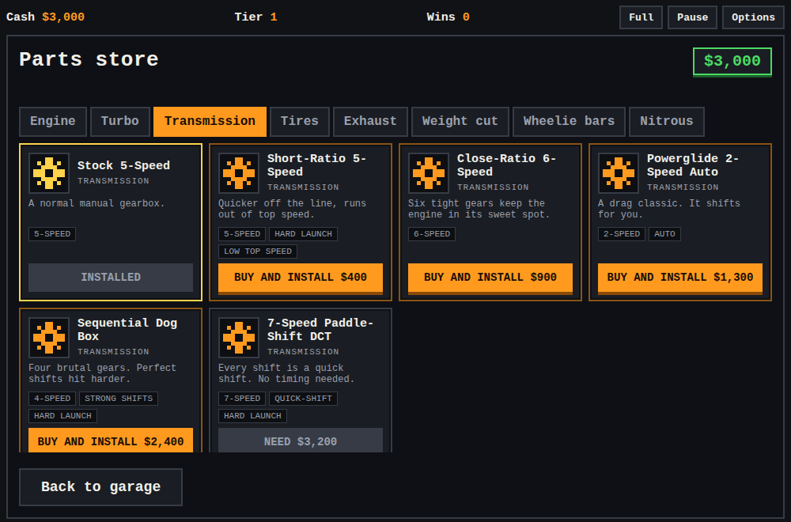

# Pixel Drag Racer

A 2D pixel-art drag racing game that runs in the browser. No build step and no dependencies.

Race a rival down the quarter mile, win cash, and spend it in the garage on upgrades, tuning and new cars.







## Play

Open `index.html` in a browser, or host it with GitHub Pages (see below).

## Controls

| Action | Keyboard (defaults) | Touch | Gamepad |
| --- | --- | --- | --- |
| Rev, then launch on green | Hold `Space`, `Up` or `W` | HOLD GAS button | RT or A |
| Shift gear | `Left Shift`, `Right Shift`, `Right` or `D` | SHIFT button | X, B or RB |
| Nitrous | `N`, `Down` or `S` | NITRO button | Y or LB |
| Pause | `P` or `Esc` | Pause button | Start |

Hold gas while the tree counts down to rev the engine. Keep it held when the light turns green to launch. A higher rev gives a better launch. Shift in the green zone of the RPM dial for a speed boost.

Open **Options** to:

- choose **right- or left-handed** touch buttons and normal or large button size,
- switch between manual and **auto-shift** (auto-shift does not get the perfect-shift boost),
- rebind the main key for gas, shift, nitrous and pause (click an action, then press a key),
- set the engine volume and turn phone vibration on or off,
- reset your save.

The game pauses by itself if you switch tabs or windows. Tap the screen or press the pause key to resume.

## Garage

The garage has three tabs, a live preview of your car, a build rating and stat bars. Part cards show the next level's effect and what you can afford.

- **Parts:** shows the part fitted in each of the 14 slots, with a Change button for each. Parts are bought in the Parts store.
- **Body and paint:** sixteen cars (plus two secret ones) in six paint colors, each with a thumbnail: JDM Sedan (starter), Tuner Hatch, Family Wagon, Muscle Coupe, Pickup Truck, Sports Coupe, Hot Rod, Supercar, the **Jet Golf Cart** ($2,500) and seven real-life-style bodies: Pony Coupe (classic fastback), Crew Cab Pickup, Full-Size SUV, Modern Muscle, Import Tuner Coupe, AWD Super Coupe and Roadster. They are original designs inspired by real vehicle shapes, with no brand names or logos. Each body adds power or grip (the Hot Rod trades grip for power). The Jet Golf Cart has a jet turbine on the back whose thrust works even when the tires are slipping, so it is the fastest car in the game. It has built-in wheelie limiters, but wheelie bars still help.
- **Style:** custom body color (any color via a color picker), stripe color, rim color, window tint, rear wing, decals (racing stripes, flames, checkered) and underglow. Style is cosmetic and saves with your game.
- **Tuning:** free sliders, saved with your game.
  - *Chassis:* spring stiffness, ride height, damping, and **wheelie bar height** (needs bars). Higher bars allow bigger wheelies, which add rear grip but are riskier.
  - *Engine:* **turbo boost pressure** (more power but slower spool; boost builds while you rev), **nitrous shot** (long and gentle, or short and strong), and **launch RPM** (low is soft and safe, high launches hard but can over-rev).
  - *Drivetrain:* **final drive**. Short gears launch harder, tall gears reach a higher top speed.

Too much power without enough grip makes the nose lift. Without wheelie bars the car can flip, so buy bars or ease off the gas.

## Graphics

The game renders smoothly at triple resolution (1440x630) with anti-aliased curves, lines and shapes, so there are no blocky pixels. Rivals pop wheelies off the line, just like you.

## Phones and tablets

The layout fits any screen:

- **Landscape phone:** the game fills the screen with see-through buttons floating over it. Nitro and shift are on the left, gas is on the right (swap sides in Options).
- **Portrait phone:** the screen sits on top and three huge buttons fill the rest.
- **Full** button for fullscreen where the browser allows it. The game pauses if you leave the tab.

## Comeback help

Lose a race (or flip your car) and the next rival runs about 6% slower per loss, up to eight losses in a row. A win resets the rival to full speed. Time trials do not count. The garage and race setup screens tell you how much the rival is easing off.

## Parts store

Open the **Parts store** from the garage. Each slot has a shelf of different parts. Buying a part installs it, and you can swap back to any part you own for free. Stock parts are always owned.

| Slot | Choices |
| --- | --- |
| Engine | Stock 4-Cylinder up to the Alcohol Hemi and the Billet Top Fuel Hemi (7 engines) |
| Turbo | None, three turbos, Roots Supercharger (no lag), Twin-Turbo Kit |
| Transmission | Stock 5-Speed, Short-Ratio 5-Speed, Close-Ratio 6-Speed, Powerglide 2-Speed Auto, Sequential Dog Box, 7-Speed Paddle-Shift DCT |
| Tires | Street Tires up to Pro Drag Slicks and Top Fuel Slicks |
| Exhaust | Stock up to Full Race Exhaust and Zoomie Headers |
| Weight cut | Stock Interior up to Full Strip Kit and Fiberglass Body Kit |
| Wheelie bars | None, Basic, Adjustable, Pro Alloy, Carbon |
| Nitrous | None up to Triple-Stage and the four-shot Progressive Controller |
| Air intake | Stock Airbox, Cold-Air, Big Throttle Body, Ram-Air, Individual Throttle Bodies (power) |
| Fuel system | Stock, High-Flow Injectors, Race Pump and Rail, E85, Methanol Injection (power) |
| ECU tune | Stock, Chip Tune, Piggyback, Standalone ECU, Pro Dyno Tune (power) |
| Clutch | Stock, Sport, Twin-Disc, Centrifugal Lock-Up, Pro Multi-Stage (launch grip) |
| Suspension | Stock, Lowering Springs, Coilovers, Drag Shocks and Ladder Bars, Pro 4-Link (grip) |
| Rear end | Open Diff, Limited-Slip, Locking Spool, 9-Inch Race Rear End, Pro Quick-Change (grip and power) |

Different engines have different powerbands, different turbos spool at different speeds, and each transmission has its own number of gears and gear ratios. Old saves from earlier versions are converted automatically.

## Race options

Press **Race setup** to choose:

- **Mode:** race a rival, or a solo time trial.
- **Distance:** 1/8, 1/4 or 1/2 mile.
- **Rival difficulty:** Easy, Normal or Hard. Harder rivals pay more.
- **Wager:** none, $100 or $300. Win to take it, lose and you pay it.

Best times are tracked for each distance.

## Run the tests

The game logic is tested headlessly in Node (no browser needed). It checks launches, flips, payouts and 300 randomized races for bad numbers and crashes.

```
npm test
```

## Files

- `index.html`: page layout and garage overlay
- `style.css`: styles
- `game.js`: game logic, physics, pixel-art drawing and engine sound
- `tests/`: headless test harness and tests
- `.github/workflows/pages.yml`: runs the tests, then deploys to GitHub Pages

## Host on GitHub Pages

1. Push these files to a repository's `main` branch.
2. Open **Settings > Pages** and set the source to **GitHub Actions**.
3. The included workflow runs the tests and deploys the game. It goes live at `https://YOUR-USERNAME.github.io/REPO-NAME/`.

You can skip the workflow and use **Deploy from a branch** (main, `/ (root)`) instead. `.nojekyll` is included for that.

## Saving

The game saves automatically to your browser's local storage: cash, wins, rival tier, owned cars, parts, paint, suspension, race options, best times and your control settings. Use **Options > Reset save** to start over. Clearing your browser data also erases the save.

## Notes

- Engine sound starts after your first key press or tap, as browsers require.

## License

MIT. See `LICENSE`.
